# 🔮 Funny Oracle

> Five AI analysts argue about whether a stock, a coin or gold goes up or down. A bull and a bear debate, a judge rules, and a Monte Carlo simulation turns the verdict into a price range. A scoreboard then checks whether any of it beats a coin flip.
>
> **Educational toy and research tool. Not investment advice. Do not trade on it.**


| | |
|---|---|
| **Assets** | US stocks (e.g. `NVDA`), crypto (e.g. `BTC-USD`), gold (`GC=F`) |
| **Modes** | **Swing** (1W / 1M / 3M) and **Scalp** (15m / 1h / 4h) |
| **LLM providers** | Gemini (default), Claude, any OpenAI-compatible local server (LM Studio) |
| **UIs** | 🎪 *The Oracle Arena* (React + FastAPI, game-show style) · 🖥️ *The Desk* (Pro, paper trading) · Streamlit fallback |
| **Data** | yfinance, FRED, alternative.me Fear & Greed, CoinGecko — all through one MCP server |

---

## Table of contents

1. [The core idea](#1-the-core-idea)
2. [How it works — the big picture](#2-how-it-works--the-big-picture)
3. [One prediction, step by step](#3-one-prediction-step-by-step)
4. [Subsystems](#4-subsystems)
   - 4.1 [MCP market-data server](#41-mcp-market-data-server-mcp_server)
   - 4.2 [LLM layer](#42-llm-layer-corellmpy)
   - 4.3 [Agents](#43-agents-agents)
   - 4.4 [Debate & Judge](#44-debate--judge)
   - 4.5 [Quant engine](#45-quant-engine-quant)
   - 4.6 [Scoreboard, cost & budget guard](#46-scoreboard-cost--budget-guard)
   - 4.7 [Web API & live events](#47-web-api--live-events-api)
   - 4.8 [Frontend — The Oracle Arena](#48-frontend--the-oracle-arena-web)
   - 4.9 [Pro mode — The Desk](#49-pro-mode--the-desk-trading-evaluation)
5. [Prompts](#5-prompts)
6. [LLMs & models](#6-llms--models)
7. [Repository layout](#7-repository-layout)
8. [Setup & running](#8-setup--running)
9. [Configuration (`.env`)](#9-configuration-env)
10. [Tests](#10-tests)
11. [Design documents](#11-design-documents)
12. [Disclaimer & license](#12-disclaimer--license)
0. [Screenshots](#0-screenshots)

---

## 1. The core idea

**The LLM never guesses the price.**

Each analyst agent outputs a **directional score** (−1 … +1) with a **confidence** and its reasoning. Those scores are combined, adjusted slightly by a judge, and then used to *tilt* a **Monte Carlo simulation driven by the asset's real historical volatility**. The final Bear / Base / Bull prices (P10 / P50 / P90) come from the model, not from the LLM's imagination.

Three more principles run through the whole codebase:

- **Tools, not memory.** Agents must fetch real data through MCP tools and may only cite numbers that came from a tool result.
- **Python does the math.** Derived numbers (indicators, aggregates, Monte Carlo, risk sizing) are computed in code. LLMs are bad at multi-step arithmetic; they read finished numbers.
- **Honesty by design.** Every prediction is stored and later scored against the actual price. The scoreboard compares the AI with a 50 % coin flip, and Pro mode compares it with non-LLM baselines.

---

## 2. How it works — the big picture

### The short version: it's a TV panel show

Imagine a late-night show about one question: *"Will Bitcoin be higher in a month?"*

1. **🔍 Research.** Before the show, a researcher reads the news and hands everyone a one-page brief.
2. **🎤 Five experts give their view.** Each expert looks at the asset from one angle only, and each one has to look up real data first. No guessing.
   - 🏢 **The CEO**: is the business (or the network) growing?
   - 📈 **Chart Wizard**: what do the price charts and indicators say?
   - 🧮 **The Accountant**: is it cheap or expensive?
   - 🌍 **The Economist**: are interest rates, the dollar and the economy helping or hurting?
   - 🧠 **Mood Reader**: is the crowd fearful or greedy?

   Each expert gives a score from **−1 (going down)** to **+1 (going up)** and says how sure they are.
3. **⚖️ The votes are combined.** Votes from experts who matter more for this asset count more. For gold, for example, the Economist counts most.
4. **🐂 vs 🐻 Debate.** A Bull and a Bear argue about the experts' views and try to knock down each other's best point.
5. **🔮 The Judge rules.** The Oracle reads everything and can nudge the final score a little (at most ±0.2), but can't overrule the whole panel.
6. **🎲 The math takes over.** A computer simulation plays out 10,000 possible futures based on how much the price really moves day to day, tilted slightly by the panel's score. The result is three numbers: a **bad case**, a **likely case** and a **good case**.
7. **📋 Keeping score.** The prediction is saved. When the date arrives, the real price is checked. Over time the Hall of Fame shows whether the AI beats a coin flip.

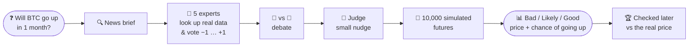

### Where the data comes from

The experts never "remember" prices. They ask a **data service** (an MCP server) that fetches fresh numbers from public sources and does all the arithmetic in code:

| Asks for… | Comes from |
|---|---|
| Prices, charts, company financials, headlines | Yahoo Finance (yfinance) |
| Interest rates, inflation, yield curve | FRED (US Federal Reserve data) |
| Crypto Fear & Greed index | alternative.me |
| Crypto market size and dominance | CoinGecko |
| Extra news (for models without built-in search) | web search + article reader |

### Who the "brains" are

Each expert is played by a large language model (LLM). You choose which one in the UI:

| Option | Good for | Cost |
|---|---|---|
| **Gemini Flash-Lite / Flash** (default) | everyday use, fast (≈ 12–50 s) | a few baht per run |
| **A local model on your own GPU** (LM Studio) | free overnight runs | ฿0, but slow (minutes) |
| **Claude** | alternative provider | per token |

A **budget guard** stops runs before spending passes your limit (default ฿100).

### The three ways to use it

| | 🎪 **Arena** | 🖥️ **Desk** (Pro) | 🧪 **Mock mode** |
|---|---|---|---|
| For | fun, demos | serious research | trying it out / UI work |
| What you get | live game show, debate, verdict, duels | trade plans, paper trading, honest stats vs simple strategies | replays saved shows |
| Real money? | no | no (paper only) | no, and no API key needed |

### The technical view

<details>
<summary><b>Click to expand: component diagram for developers</b></summary>

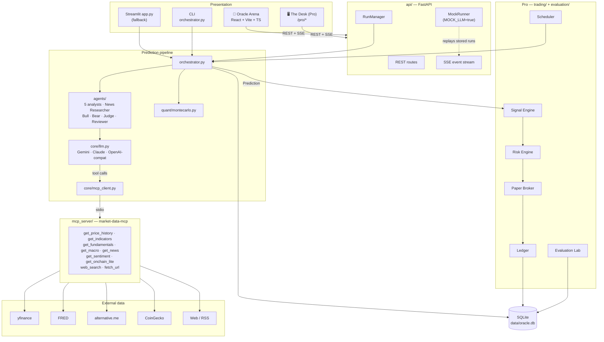

**Layers in one sentence each**

| Layer | Responsibility |
|---|---|
| **Presentation** | Pick ticker / mode / horizon / model, watch the run live, read the verdict, check the scoreboard. |
| **API** (`api/`) | Starts runs as asyncio tasks, streams every step over Server-Sent Events, serves history, scoreboard, budget and Pro endpoints. |
| **Orchestration** (`orchestrator.py`) | Classifies the asset, picks agents and weights, runs analysts in parallel, runs debate + judge, runs the quant engine, saves the result. |
| **Agents** (`agents/`) | Role-specific LLM agents with their own prompts and allowed tools. |
| **LLM layer** (`core/llm.py`) | One interface over three providers; runs the tool-calling loop, validates JSON, tracks cost. |
| **Tool layer** (`mcp_server/`) | A Model Context Protocol server exposing market data as compact JSON tools. Also usable from Claude Code. |
| **Quant** (`quant/`) | Turns the final score into a price distribution with Monte Carlo (GBM). |
| **Storage** | One SQLite file: predictions, agent outputs, LLM usage, cache, and Pro tables. |
| **Pro** (`trading/`, `evaluation/`) | Turns predictions into paper trades and measures them against baselines. |

</details>

---

## 3. One prediction, step by step

Example: `BTC-USD`, swing, 1M. This is the same story as §2, with the real function and field names.

<details>
<summary><b>Click to expand: sequence diagram</b></summary>

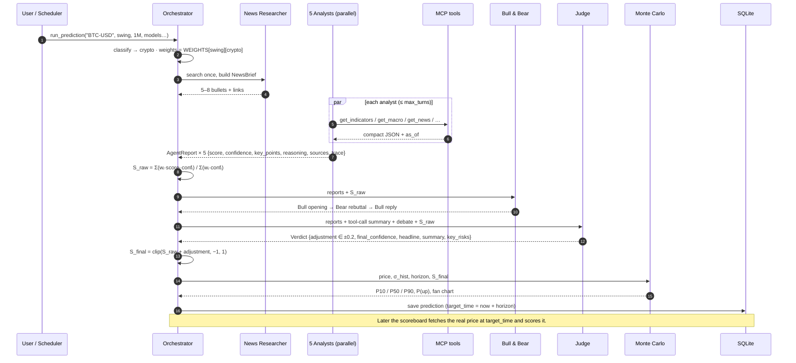

</details>

Every step also emits an **event** (`agent_started`, `tool_call`, `debate_turn`, `judge`, `quant`, …) that the web UI renders live.

---

## 4. Subsystems

### 4.1 MCP market-data server (`mcp_server/`)

Built with the MCP Python SDK (`FastMCP`, stdio transport). The in-app agents call it through `core/mcp_client.py`; Claude Code can use the same server during development.

| Tool | Arguments | Returns | Source |
|---|---|---|---|
| `get_price_history` | `ticker, interval="1d", period=None` | summary (last, % change, high/low) + recent bars | yfinance |
| `get_indicators` | `ticker, interval="1d"` | RSI, MACD, SMAs/EMA, Bollinger, ATR, volume z-score, support/resistance | computed from OHLCV |
| `get_fundamentals` | `ticker` | P/E, EV/EBITDA, margins, growth, FCF, debt/equity, analyst targets | yfinance |
| `get_macro` | – | rates, inflation, real yield, yield curve, DXY, VIX (+ ~1-month change) | FRED + yfinance |
| `get_news` | `ticker, limit=6` | headlines with publisher, date, link | yfinance |
| `get_sentiment` | `asset_type, ticker=None` | VIX, distance from 52-week high, 1M/3M returns, crypto Fear & Greed | yfinance + alternative.me |
| `get_onchain_lite` | `coin` | market cap, rank, dominance, distance from ATH | CoinGecko |
| `web_search` | `query, limit=6` | title, URL, source, date, snippet | RSS / web |
| `fetch_url` | `url, max_chars=1500` | readable article text | public web page |

**Contract every tool follows**

- Returns a JSON envelope `{as_of, data}` or `{as_of, error}` — it never raises, so one broken source can't kill an agent.
- Output is compact (≈ 2 KB): summaries and recent bars, never raw full history.
- Results are cached in SQLite (short TTL for intraday prices, longer for fundamentals and macro).
- `web_search` / `fetch_url` exist mainly for providers without built-in search grounding (local models).

### 4.2 LLM layer (`core/llm.py`)

One facade, `LLM`, chooses a backend from `LLM_PROVIDER` or from the model ID passed per run:

| Backend | SDK / transport | Tool loop | Final answer | Search |
|---|---|---|---|---|
| `GeminiBackend` | `google-genai` | function calls executed concurrently, returned as `function_response`; `FINAL_NUDGE` on the last tool turn | function calling mode `NONE` + JSON schema | Google Search grounding (sources from `grounding_metadata`) |
| `ClaudeBackend` | Anthropic SDK | `tool_use` → `tool_result`, handles `pause_turn` | `tool_choice: none` | Anthropic web search tool (`max_uses: 3`) |
| `OpenAICompatBackend` | `httpx` → `/chat/completions` (LM Studio etc.) | tool turns with thinking off; stops early on repeated identical calls | strict `response_format` JSON schema | none → uses the `web_search` MCP tool |

**What the loop guarantees**

- **Allowed tools only.** Each agent has an allow-list; anything else is rejected.
- **Structured output.** `extract_json` tolerates code fences, prose and escaping; `parse_output` validates with Pydantic (ranges like `score ∈ [-1, 1]` are enforced in Python, because some servers ignore schema min/max).
- **Repair, not crash.** Gemini/Claude: ask the same conversation to fix the JSON, then fall back to a JSON-mode conversion call (`FORMAT_SYSTEM`). Local: up to `LOCAL_VALIDATION_RETRIES` attempts, each sending back the invalid output plus the list of problems.
- **Transport retries.** Gemini retries 429/5xx with exponential backoff; Claude client `max_retries=3`.
- **Thinking control.** Gemini `ThinkingConfig(thinking_level=…)`; Claude `effort` (default `low`); local `reasoning_effort: "none"` to switch thinking off per request, with `quick` / `deep` presets (see §6).
- **Concurrency.** asyncio semaphore (`MAX_CONCURRENCY`) plus a process-wide lock for local calls (`LOCAL_CONCURRENCY`).
- **Cost.** `BudgetGuard.check_call()` runs before every call; `cost.record(...)` logs input / output / thinking tokens and search calls per agent and run. Local calls cost ฿0 but are still logged.
- **Failures become data.** Exceptions turn into `AgentResult.error`; the orchestrator drops that agent and renormalises the weights, and the UI shows it as "absent".

### 4.3 Agents (`agents/`)

All analysts share one output schema:

```python
class AgentReport(BaseModel):
    agent: str
    score: float          # -1 (strong down) … +1 (strong up)
    confidence: float     # 0 … 1
    key_points: list[str] # 3–5 bullets, each citing a tool number
    reasoning: str        # ≤ 120 words
    sources: list[str]    # tool names / URLs
    trace: list[ToolCall] # every tool call: name, args, latency, size
    # Pro (v2 prompts) adds optional: scenario_probs, key_levels, invalidation
```

| Agent | Arena character | Main tools | Looks at (stock · crypto · gold) |
|---|---|---|---|
| **Business** | 🏢 The CEO | fundamentals, news (+ search) | growth, moat, guidance · adoption, ETF flows, regulation · central-bank & ETF demand |
| **Technical** | 📈 Chart Wizard | price_history, indicators | trend, momentum, support/resistance, volume, volatility regime |
| **Valuation** | 🧮 The Accountant | fundamentals, price_history, onchain_lite | P/E vs history, analyst target · price vs long MA, NVT-style proxies · price vs real yield / DXY |
| **Macro** | 🌍 The Economist | macro, news (+ search) | rates, yield curve, risk-on/off · liquidity, DXY · **real yield & DXY** (most important for gold) |
| **Psychology** | 🧠 Mood Reader | sentiment, news, price_history (+ search) | VIX, distance from highs · Fear & Greed, euphoria · safe-haven demand |

Helper agents:

| Agent | Role |
|---|---|
| **News Researcher** | Searches once before the analysts and shares a short `NewsBrief` with Business, Macro and Psychology (saves search calls; disabled in point-in-time backtests). |
| **Bull 🐂 / Bear 🐻** | Debate the five reports (no tools). |
| **Judge 🔮 The Oracle** | Rules on the debate and nudges the score. |
| **Reviewer** (Pro) | Writes one short post-mortem per closed paper trade, on the cheapest available model. |

**Weights by mode × asset** (in `config.py`)

| | Business | Technical | Valuation | Macro | Psychology |
|---|---|---|---|---|---|
| Swing · Stock | 0.25 | 0.15 | 0.25 | 0.15 | 0.20 |
| Swing · Crypto | 0.15 | 0.25 | 0.10 | 0.20 | 0.30 |
| Swing · Gold | 0.10 | 0.20 | 0.15 | 0.40 | 0.15 |
| Scalp · all | – | 0.55 | – | 0.10 | 0.35 |

Scalp mode skips Business and Valuation (they don't change in 15 minutes) and runs a lighter Macro.

### 4.4 Debate & Judge

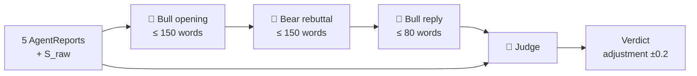

- **Debate** (`agents/debate.py`): one round, three sequential turns, no tools. Each side sees a JSON digest of the reports (score, confidence, key points, reasoning; failed agents marked absent) and the transcript so far. Each turn must name the opponent's strongest point (`DebateOutput{argument, strongest_opponent_point}`). Over-long text is clipped. If a turn fails, the judge gets the turns completed so far.
- **Judge** (`agents/judge.py`): sees the reports **plus a summary of which tools each analyst actually called**, the debate and `S_raw`. It may adjust only when the debate exposes something the weighted average missed (uncited numbers, stale data, one-sided evidence) and is **capped at ±0.2**, so it can't overrule the whole team. Output: `adjustment`, `final_confidence`, a witty `headline`, `summary`, `key_risks`. In Pro mode it can also recommend FLAT via `no_trade_reason`.

### 4.5 Quant engine (`quant/`)

```
S_raw   = Σ(wᵢ · scoreᵢ · confᵢ) / Σ(wᵢ · confᵢ)
S_final = clip(S_raw + judge.adjustment, −1, 1)

σ       = stdev(log returns)        swing: ~1y daily · scalp: recent bars of the chosen interval
μ_base  = 0                          no historical drift assumed
μ_adj   = S_final · λ · σ / √T       per step, λ = 0.5
paths   = 10,000 GBM paths → price at horizon T

Output  = P10 (Bear) · P50 (Base) · P90 (Bull) · P(price > now) · fan chart P10–P90
```

Why λ = 0.5: even a fully confident team (|S| = 1) can move the median by only about half a sigma over the horizon — much more realistic than letting an LLM claim +40 %.

### 4.6 Scoreboard, cost & budget guard

- **Scoreboard** (`core/scoreboard.py`): finds predictions past their `target_time`, fetches the actual price, and reports **direction hit rate vs 50 %**, **band coverage** (share of actual prices inside P10–P90; ≈ 80 % means well calibrated), **MAPE** of P50, an **agent leaderboard** and a **model leaderboard**.
- **Auto-Scalp**: predicts `BTC-USD` 15m on a timer so real scoreboard data accumulates (capped by `AUTO_SCALP_MAX_RUNS`).
- **Cost tracker** (`core/cost.py`): per-model prices in `config.PRICES`; every call's tokens and search calls are stored in `llm_usage`.
- **Budget guard**: before each run the expected cost is estimated; if `spent + estimate > BUDGET_THB` the run is refused (HTTP 402 in the API, "The Oracle is out of coins" in the UI).

### 4.7 Web API & live events (`api/`)

- **FastAPI** app (`api/main.py`) serving REST under `/api/*`, the built frontend from `web/dist`, and Pro routes under `/api/pro/*`.
- **RunManager** runs predictions as asyncio tasks, keeps an event buffer per run (late subscribers and reloads replay everything), and limits concurrent runs.
- **MockRunner** (`MOCK_LLM=true`): replays stored predictions as realistic timed event streams — **no LLM calls, ฿0**. All UI development uses this; `data/seeds.json` ships demo predictions.

Main endpoints: `GET /api/models` (models with price, speed, search support, estimated cost) · `GET /api/tickers/search` · `GET /api/quote/{ticker}` · `GET /api/history/{ticker}` · `POST /api/predictions` → `run_id` · `GET /api/runs/{run_id}/events` (SSE) · `GET /api/predictions[/{id}]` · `POST /api/duels` · `GET /api/scoreboard` · `GET /api/budget` · `/api/autoscalp/*`.

SSE event types: `run_started`, `stage`, `agent_started`, `tool_call`, `tool_result`, `search`, `agent_done`, `agent_failed`, `aggregate`, `debate_turn`, `judge`, `quant`, `cost_update`, `run_done`, `error` (+ Pro: `signal_created`, `signal_flat`, `risk_rejected`, `order_placed`, `order_filled`, `position_closed`, `breaker_tripped`, `equity_tick`).

### 4.8 Frontend — The Oracle Arena (`web/`)

React + Vite + TypeScript, Tailwind, Framer Motion, lightweight-charts, html-to-image, canvas-confetti.

| Screen | What happens |
|---|---|
| **Arena** | Pick ticker (search + preset chips with sparklines), mode, horizon and model (with cost estimate) → **Start the show**. Five podiums light up, tool-call bubbles appear, a tug-of-war rope shows `S_raw`, the debate types out, the Oracle reveals the verdict, and the fan chart draws in. |
| **Duel** | Two models predict the same asset side by side; head-to-head comparison and model win rates. |
| **Hall of Fame** | AI vs coin flip, band coverage, agent podium, model leaderboard, pending predictions, Auto-Scalp control. |
| **Replay `/p/:id`** | Re-plays a stored prediction as a live show. |
| **Share card** | 1080 × 1350 PNG of a prediction, always with "not investment advice". |

The Streamlit `app.py` still works as a simple fallback UI.

### 4.9 Pro mode — The Desk (`trading/`, `evaluation/`)

A calm, professional research mode that asks the honest question: **does the LLM system add value after costs, compared with simple baselines?** Paper money only.

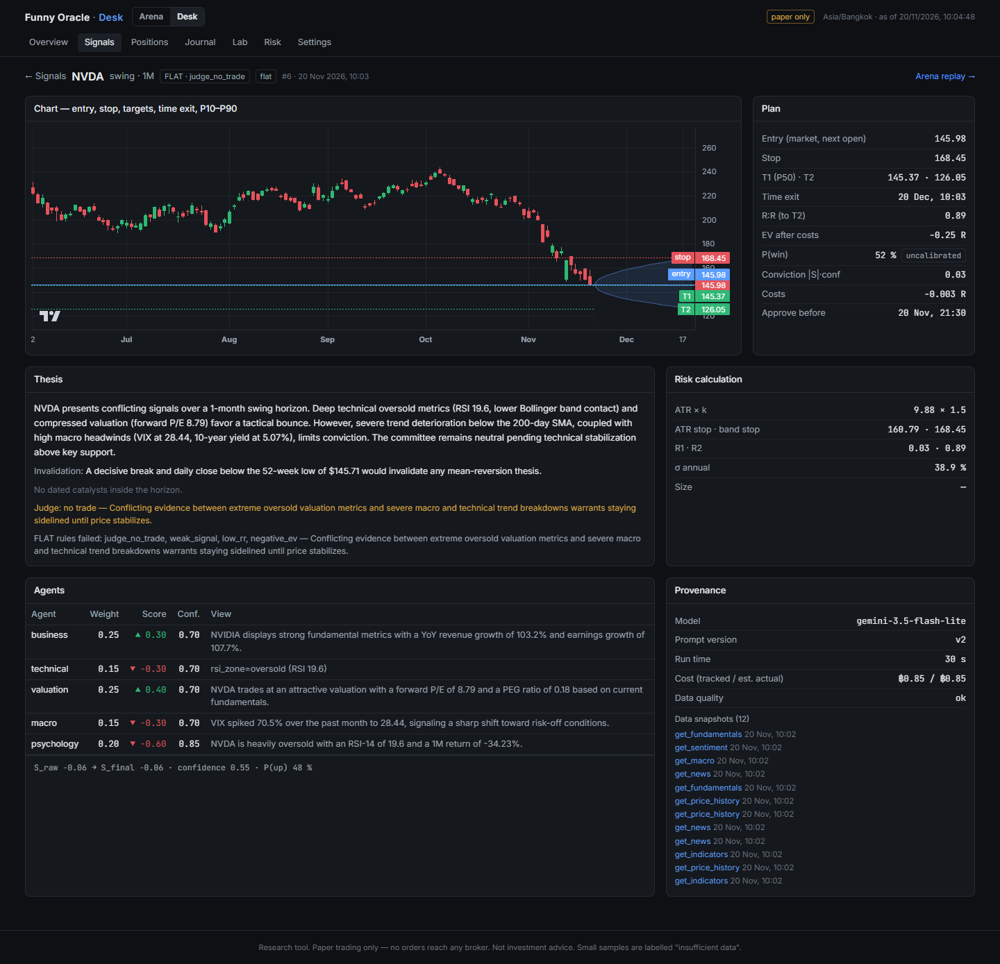

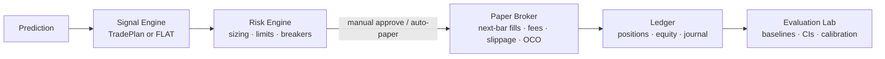

- **Signal Engine** (`trading/signals.py`): FLAT unless |S_final|, confidence, reward:risk and expected value after costs all clear their thresholds. Stops from ATR and the P10/P90 band; targets from P50/P90.
- **Risk Engine** (`trading/risk.py`): risk per trade, position/asset-class/gross limits, correlation guard, daily loss limit, max-drawdown halt, optional Kelly cap (only once calibration has enough samples). Every rejection is logged with its rule.
- **Paper Broker & Ledger**: fills at the next bar's open, realistic costs, NYSE hours for stocks, conservative intrabar handling (stop wins ties), gap fills, journal with R multiple, MAE/MFE and Reviewer post-mortem.
- **Scheduler** (`trading/scheduler.py`): daily swing runs per watchlist asset (after the relevant market close), routes swing jobs to the free local model inside an overnight window (`PRO_LOCAL_WINDOW`) and falls back to Gemini or skips when needed.
- **Evaluation Lab** (`evaluation/`): compares buy & hold, cash, random (1,000 seeded runs), momentum, quant-only (no LLM), single agents, team without debate, the full system, and each model. Reports hit rate with Wilson CIs, Brier score and calibration, Sharpe with bootstrap CIs, drawdown, expectancy, and shows "insufficient data" below minimum samples.
- **Leakage rules**: LLM backtests on dates before a model's knowledge cutoff (`MODEL_CUTOFFS`) are labelled *contaminated* and never count as evidence; backtests disable live search and current fundamentals.
- **Reproducibility**: every prediction, plan and trade links to an `experiments` row (hash of prompt version, models, weights, risk and cost parameters).

---

## 5. Prompts

Prompts live as Markdown files, not in code, and are **versioned**:

| Folder | Used by | Notes |
|---|---|---|
| `agents/prompts/v1/` | Arena, CLI, Streamlit | Original prompts. Each file is pinned by a sha256 test so they can't change by accident. |
| `agents/prompts/v2/` | Pro / The Desk | v1 plus a "Desk (research) rules" block on the analyst and judge prompts; asks for scenario probabilities, key levels, invalidation and catalysts. Pro runs use temperature 0.2. |

The prompt version is stored with every prediction.

### Analyst template (`_analyst.md`)

Shared by all five analysts. Placeholders: `{role}`, `{ticker}`, `{asset_type}`, `{mode}`, `{horizon}`, `{now}`, `{focus}` (role-specific focus for the asset type), `{context}` (e.g. NewsBrief), `{search_rule}`, `{max_turns}`.

Rules it gives the model:

1. Gather real data with tools before concluding; **every number must come from a tool result**.
2. Judge only from your own role — other analysts cover the other angles.
3. Check each result's `as_of`; if data is older than the horizon, say so and lower confidence.
4. If a tool fails, retry once with different arguments, then continue without it and lower confidence.
5. Stay within `{max_turns}` and call independent tools in parallel.
6. `score` −1 … +1 over the horizon (0 = no edge); `confidence` 0 … 1, lower when data conflicts, is missing or stale.
7. Reply with JSON only: `score`, `confidence`, 3–5 `key_points` citing concrete numbers, `reasoning` ≤ 120 words, `sources`.

### Debate prompts (`bull.md`, `bear.md`, `bull_reply.md`)

Placeholders: `{ticker}`, `{asset_type}`, `{horizon}`, `{s_raw}`. Each side argues its case from the reports only, must rebut the opponent's strongest point, and returns `{argument, strongest_opponent_point}`. Word limits: 150 / 150 / 80.

### Judge prompt (`judge.md`)

Placeholders: `{ticker}`, `{asset_type}`, `{mode}`, `{horizon}`, `{s_raw}`. The judge acts as an impartial investment-committee chair: adjust only when the debate reveals something the average missed, distrust claims not backed by the tool trace, lower confidence when analysts disagree or data is poor, never exceed ±0.2. "No adjustment" is a valid answer.

### Prompt-design lessons (from testing small local models)

- Put the range **in the field description and the system prompt** ("decimal from −1.0 to 1.0, e.g. 0.35, NOT a percentage") — otherwise small models answer 72.5.
- Make the schema allow every legitimate answer (nullable where "null" is allowed) — constrained decoding will otherwise silently force a wrong value.
- The final agent turn must be JSON, not free text (shorter and faster).
- Don't ask the model to compute; hand it finished numbers from the tools.

Full findings: [`LOCAL_LLM.md`](LOCAL_LLM.md).

---

## 6. LLMs & models

Model IDs are **never hard-coded** — they come from `.env` / `config.py`, and the UI can override the analyst and judge models per run.

| Provider | Typical models | Cost | Speed (swing run) | Modes | Search |
|---|---|---|---|---|---|
| **Gemini** (default) | `gemini-3.5-flash-lite` (default for every role), `gemini-3.8-flash` | ≈ ฿0.6–1.6 / ฿2–4 per swing run (tracked) | ~12–50 s | swing + scalp | Google Search grounding |
| **Local** (LM Studio, OpenAI-compatible) | `local:<model id>`, e.g. `local:prism-ml/bonsai-27b` | ฿0 | Quick ≈ 6–7 min · Deep much longer | **swing only** (too slow for scalp) | via `web_search` MCP tool |
| **Claude** | `CLAUDE_*_MODEL` in `.env` | per `config.PRICES` | – | swing + scalp | Anthropic web search |
| **Demo** | `demo:rule-based` | ฿0 | instant | Desk demo | – |

**Which model runs which step**

| Step | Model setting | Thinking |
|---|---|---|
| 5 analysts + News Researcher | `ANALYST_MODEL` (or per-run override) | low / off on tool-selection turns |
| Bull, Bear, Judge | `JUDGE_MODEL` (or per-run override) | higher; the judge is called once and matters most |
| Scalp mode | `SCALP_MODEL` (fast, Gemini) | low |
| Pro swing jobs | `PRO_SWING_MODEL` → local Quick when reachable, else Flash-Lite | preset |
| Pro scalp jobs | `PRO_SCALP_MODEL` (Gemini only) | low |
| Reviewer post-mortems | cheapest available | low |

**Local thinking presets** (`LOCAL_THINK_PRESET`)

- `quick` — thinking off everywhere (`reasoning_effort: "none"`). Fast; fine because tools pre-compute the math.
- `deep` — thinking on only for final synthesis turns (analyst report, Bull/Bear, Judge). Much slower, better at reasoning.


Tested hardware: RTX 4050 Laptop (6 GB VRAM) running a 1-bit 27B model (~3.9 GB). Details and benchmarks in [`LOCAL_LLM.md`](LOCAL_LLM.md).

---

## 7. Repository layout

```
funny-oracle/
├── orchestrator.py        # main pipeline (also a CLI)
├── config.py              # weights, horizons, λ, models, PRICES, MODEL_CUTOFFS, Pro defaults
├── app.py                 # Streamlit fallback UI
├── core/                  # llm.py, mcp_client.py, schemas.py, scoreboard.py, cost.py, asset.py, …
├── agents/                # business, technical, valuation, macro, psychology,
│   │                      # news_researcher, debate, judge, reviewer
│   └── prompts/v1, v2/    # versioned system prompts (.md)
├── mcp_server/            # server.py (FastMCP tools), data_sources.py, indicators.py
├── quant/                 # montecarlo.py
├── api/                   # FastAPI: main.py, routes/, runs.py, mock_runner.py, events.py
├── web/                   # React + Vite frontend (Arena + Desk), e2e scripts
├── trading/               # Pro: signals, risk, broker_paper, ledger, scheduler, calendar, costs
├── evaluation/            # Pro: baselines, backtest, metrics, stats, calibration, ablation, report
├── scripts/               # dev.ps1, seeds.py, run_agents.py, auto_scalp.py, pro_demo.py, …
├── tests/                 # pytest (incl. tests/pro)
├── data/                  # oracle.db (git-ignored), seeds.json
├── methods/ knowledge/ theses/   # extension points (analysis methods, RAG notes, user theses)
├── docs/                  # screenshots, plans
└── ARCHITECTURE.md · REDESIGN.md · LOCAL_LLM.md · PRO.md · PROGRESS.md
```

---

## 8. Setup & running

Requirements: **Python 3.11+**, **Node.js LTS**. Commands below are for Windows PowerShell.

```powershell
git clone https://github.com/Dollar-P/funny-oracle.git; cd funny-oracle
py -3 -m venv .venv
.venv\Scripts\python -m pip install -r requirements.txt
copy .env.example .env          # add GEMINI_API_KEY / FRED_API_KEY for real runs
cd web; npm install; cd ..
```

### Quick start — no API key, no cost

Mock mode replays the seeded predictions as live shows.

```powershell
.venv\Scripts\python scripts\seeds.py load
scripts\dev.ps1                 # → http://localhost:5173  (mock mode)
```

### Real runs

```powershell
scripts\dev.ps1 -Real                                           # web UI with real LLM calls

# single process (build the frontend first)
cd web; npm run build; cd ..
.venv\Scripts\python -m uvicorn api.main:app --port 8000        # → http://localhost:8000

# CLI
.venv\Scripts\python orchestrator.py NVDA swing 1M
.venv\Scripts\python orchestrator.py BTC-USD scalp 15m
.venv\Scripts\python scripts\run_agents.py GC=F --agents all

# Streamlit fallback
.venv\Scripts\streamlit run app.py                              # → http://localhost:8501

# Auto-Scalp (fills the scoreboard)
.venv\Scripts\python scripts\auto_scalp.py --runs 4 --interval 900
```

### The Desk (Pro) demo — no network, no LLM, no money

```powershell
.venv\Scripts\python.exe scripts\pro_demo.py
$env:PRO_DEMO_DIR = "data\pro_demo"
$env:ORACLE_DB    = "data\pro_demo\pro_demo.db"
$env:MOCK_LLM     = "true"
.venv\Scripts\python.exe -m uvicorn api.main:app --port 8011    # → http://127.0.0.1:8011/pro
Remove-Item Env:PRO_DEMO_DIR, Env:ORACLE_DB, Env:MOCK_LLM       # when done
```

### Use the MCP server from Claude Code

```powershell
claude mcp add market-data -- <repo>\.venv\Scripts\python.exe <repo>\mcp_server\server.py
```

---

## 9. Configuration (`.env`)

| Variable | Purpose |
|---|---|
| `GEMINI_API_KEY`, `FRED_API_KEY`, `ANTHROPIC_API_KEY` | API keys (`.env` is git-ignored) |
| `LLM_PROVIDER` | `gemini` · `claude` · `local` |
| `ANALYST_MODEL`, `JUDGE_MODEL`, `SCALP_MODEL` | default models per role |
| `ENABLE_SEARCH` | search grounding on/off |
| `LOCAL_BASE_URL`, `LOCAL_MODEL` | OpenAI-compatible server and model |
| `LOCAL_CONCURRENCY`, `LOCAL_TIMEOUT_S`, `LOCAL_MAX_TURNS`, `LOCAL_THINK_PRESET`, `LOCAL_MAX_TOKENS_THINK`, `LOCAL_MAX_TOKENS_FAST` | local-model tuning |
| `BUDGET_THB`, `BUDGET_BASIS`, `USD_THB` | spending cap (default ฿100) and display rate |
| `MOCK_LLM`, `MOCK_SPEED` | replay mode for UI work |
| `AUTO_SCALP_MAX_RUNS` | Auto-Scalp cap |
| `PRO_LOCAL_WINDOW`, `PRO_TZ`, `PRO_STARTING_EQUITY`, `ALLOW_CRYPTO_SHORT`, `MODEL_CUTOFFS` | Pro / Desk settings |
| `PRO_DEMO_DIR`, `ORACLE_DB` | alternate data directory / database |

See `.env.example` for the full list and defaults.

---

## 10. Tests

```powershell
.venv\Scripts\python -m pytest -q
# offline (skip tests that fetch real market data)
.venv\Scripts\python -m pytest -q --ignore tests\test_mcp_tools.py --ignore tests\test_mcp_client.py
# Pro only
.venv\Scripts\python -m pytest tests/pro api/tests/test_pro_api.py
# UI end-to-end (dev server running)
node web/e2e/pro.mjs <url> <outDir>
```

---

## 11. Design documents

| Document | Contents |
|---|---|
| [`ARCHITECTURE.md`](ARCHITECTURE.md) | Original system design: agents, MCP tools, quant engine, scoreboard, cost guard |
| [`REDESIGN.md`](REDESIGN.md) | The Oracle Arena: React + FastAPI, SSE events, screens, visual design |
| [`LOCAL_LLM.md`](LOCAL_LLM.md) | Local model tests, intelligence eval, thinking control, prompt lessons |
| [`PRO.md`](PRO.md) | The Desk: signal/risk engines, paper broker, evaluation methodology |
| [`PROGRESS.md`](PROGRESS.md) | Checkpoint status and changes from the original plans |

---

## 12. Disclaimer & license

Funny Oracle is an **educational toy and research tool**. Its predictions are for fun and for studying how LLM agents behave — they are **not investment advice**, and the most likely honest result is that the system does not beat simple baselines after costs. Pro mode trades paper money only.

MIT License — see [`LICENSE`](LICENSE).

---

## 0. Screenshots

### 🎪 The Oracle Arena (web UI)

| Live show | Verdict |
|---|---|
| 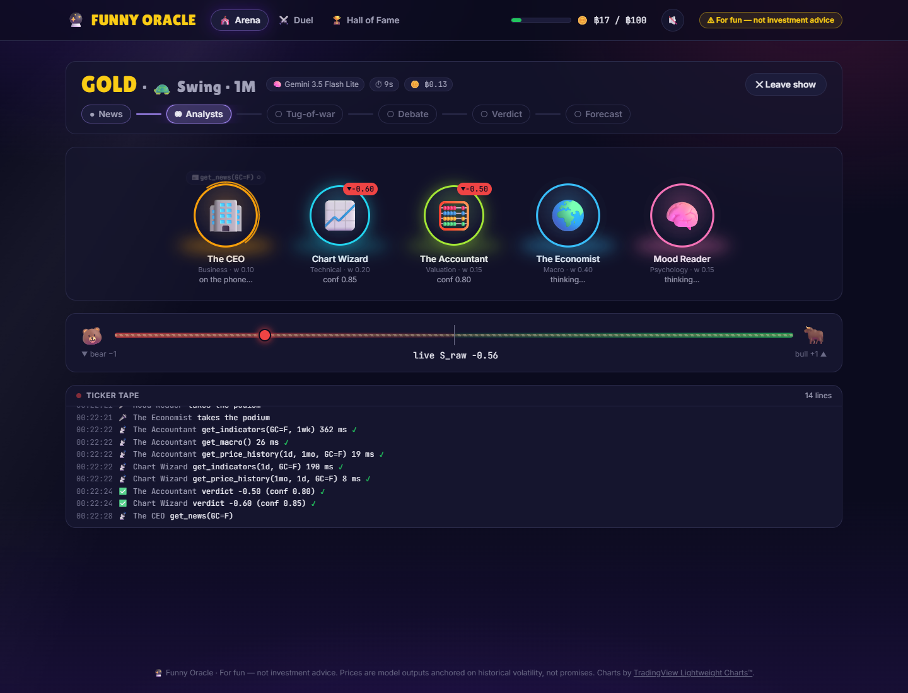 |  |
| **Model vs Model** | **Hall of Fame** |
|  | 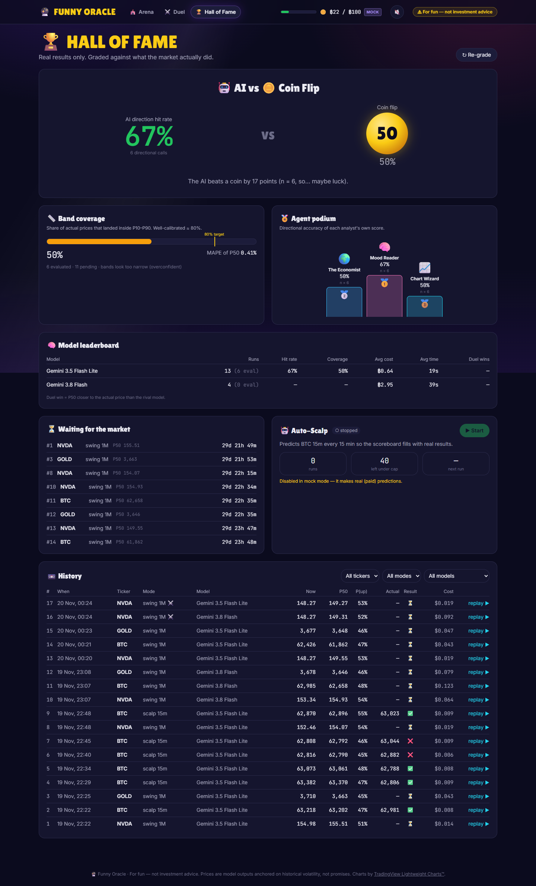 |
| **Setup** | **Share card** |
|  | 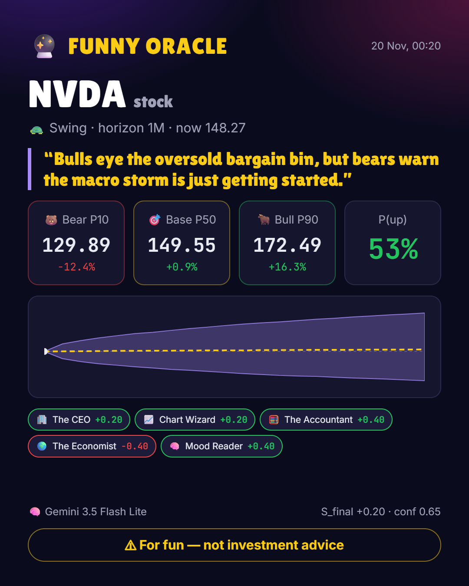 |

More: [debate](docs/arena_debate_real.png) · [agent drawer](docs/agent_drawer_real.png) · [replay page](docs/replay.png) · [phone](docs/mobile_arena.png)

The Desk (Pro mode) screenshot is in [§4.9](#49-pro-mode--the-desk-trading-evaluation).

### Streamlit fallback

| Swing · Gold (light) | Swing · Gold (dark) | Scalp · BTC 15m |
|---|---|---|
| 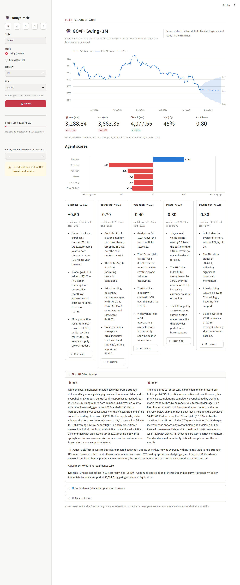 |  | 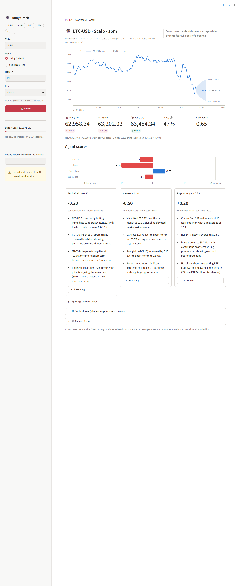 |

---
