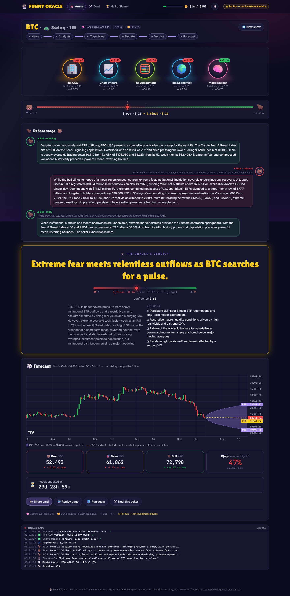
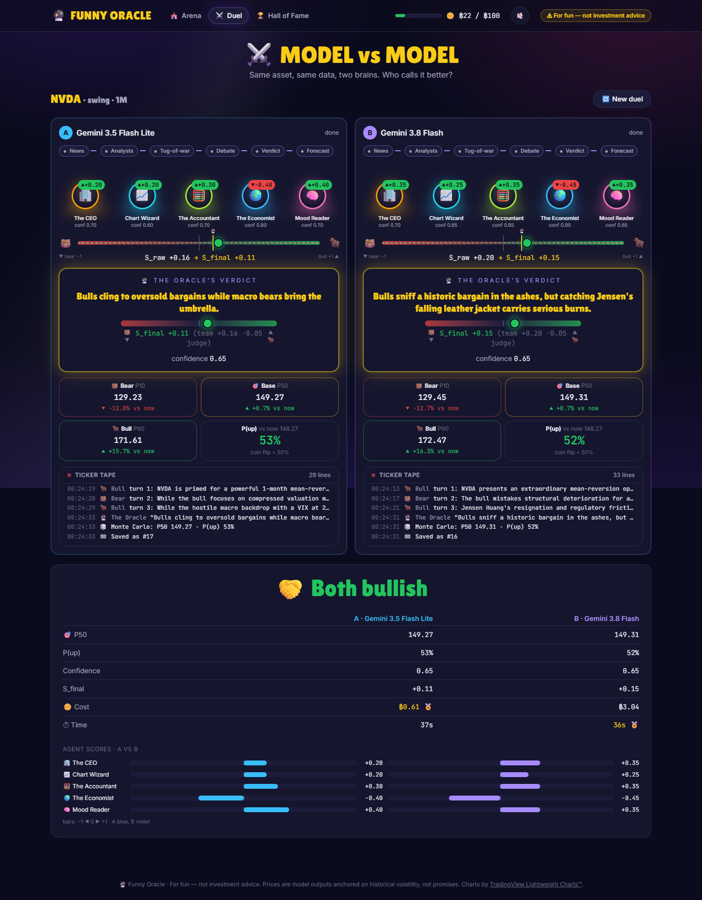
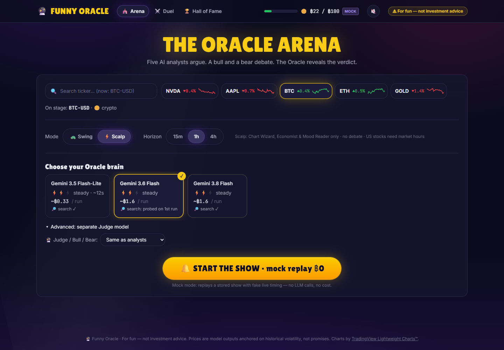
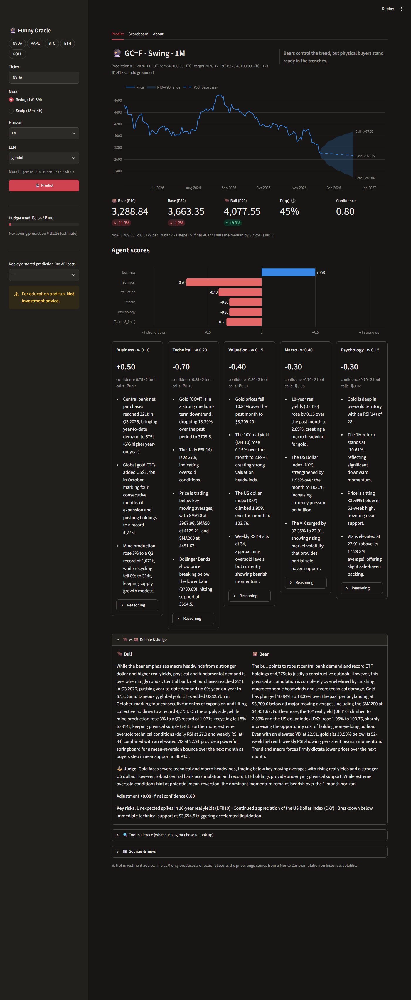
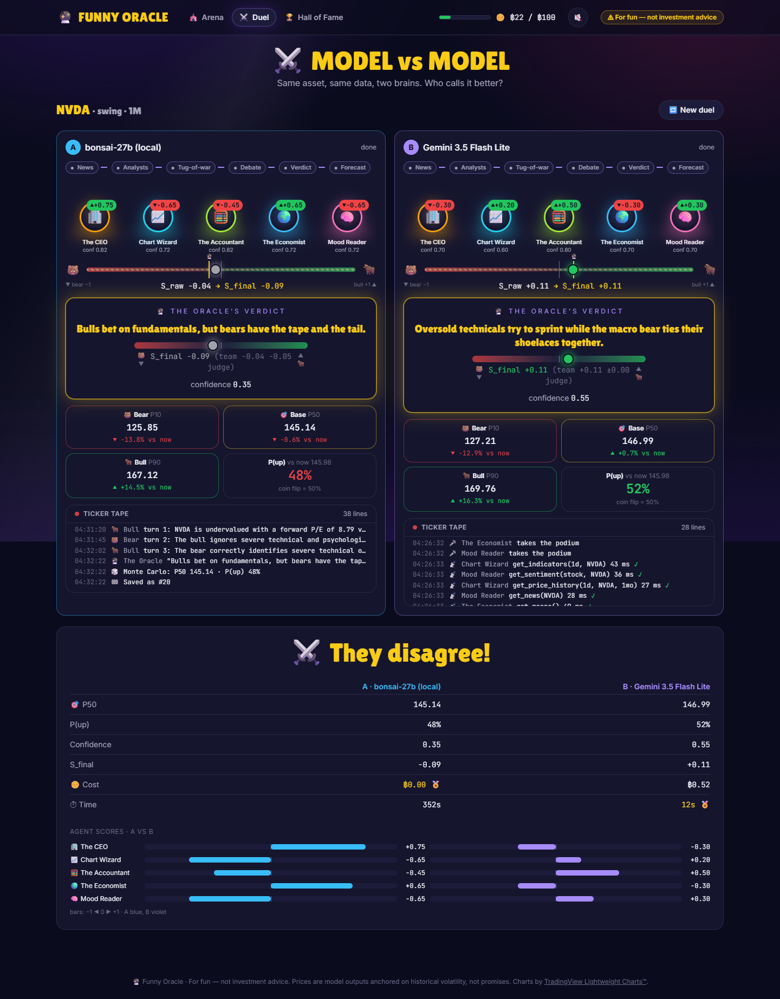

# 🔮 Funny Oracle

Five AI analysts argue about whether a stock, a coin or gold goes up or down — then a Monte Carlo
simulation turns their verdict into a price range, and a scoreboard checks them against a coin flip.

> **For education and fun. Not investment advice.** See [Disclaimer](#disclaimer).

- **Agentic:** each analyst (Business, Technical, Valuation, Macro, Psychology) decides which market-data
  tools to call through an MCP server (`market-data-mcp`), up to 8 tool turns.
- **Debate:** a Bull and a Bear argue from the reports; a Judge may adjust the team score by at most ±0.2.
- **Grounded numbers:** the LLM only produces a direction score in [-1, +1]. The P10 / P50 / P90 range comes
  from 10,000 simulated paths using real historical volatility — a fully confident team can move the median
  by at most ½σ over the horizon.
- **Honest:** the Hall of Fame / Scoreboard tracks direction hit rate vs 50%, P10–P90 band coverage, MAPE,
  and agent and model leaderboards.

See `ARCHITECTURE.md` for the backend design, `REDESIGN.md` for the web UI, and `PROGRESS.md` for build
status, decisions and known issues.

## 🎪 The Oracle Arena (web UI)

A late-night game show: five analysts on podiums call tools live, a bull and a bear debate, and the Oracle
reveals the verdict, followed by a fan chart. React + FastAPI, with every step streamed over Server-Sent Events.

| Live show (real run, GOLD) | Verdict & forecast (real run, BTC) |
|---|---|
|  |  |
| **Model vs Model** (real duel, NVDA) | **Hall of Fame** |
|  |  |
| **Setup** | **Share card** (1080×1350 PNG) |
|  |  |

More: [debate](docs/arena_debate_real.png) · [agent drawer](docs/agent_drawer_real.png) ·
[replay page](docs/replay.png) · [phone](docs/mobile_arena.png).

- **Arena**: ticker search + preset chips with live sparklines, Swing/Scalp + horizon, choose the "Oracle
  brain" (cost estimate, speed and search support per model; optional separate Judge model), then
  **START THE SHOW**. Podiums show *thinking → on the phone (tool call) → score*; the speech bubbles show
  real tool calls and searches; the rope moves as each analyst finishes; the debate types itself out
  (click to skip); then drumroll → verdict → confetti (bullish) / red rain (bearish) / 🤷 (neutral) →
  candles + P10–P90 fan + Bear/Base/Bull cards. Scalp shows a countdown that flips to ✅/❌ with the real price.
- **Duel**: two models on the same asset at the same time, then a head-to-head (P50, P(up), confidence,
  per-agent score bars, cost, time, "🤝 Both bullish" / "⚔️ They disagree!").
- **Hall of Fame**: AI hit rate vs a flipping coin, band coverage vs the 80% target, MAPE, agent podium,
  model leaderboard (incl. duel wins), pending predictions with countdowns, filterable history with replay
  links, and the Auto-Scalp control.
- **Replay** `/p/<id>`: any stored prediction; **▶ Replay the show** re-streams it live, free.
- Budget meter in the top bar (tracked spend; hover for the estimated-actual figure). A budget refusal shows
  "The Oracle is out of coins". Optional synthesized sounds (🔇 off by default). `prefers-reduced-motion`
  turns off the drumroll, typewriter, confetti, rain and light sweeps.

The original Streamlit app is still supported as a fallback:

| Swing · Gold (light) | Swing · Gold (dark) | Scalp · BTC 15m |
|---|---|---|
|  |  |  |

## Setup (Windows / PowerShell)

Requirements: **Python 3.14** and **Node.js** (LTS is fine; only for the web UI). Developed on Windows; the
commands below are PowerShell.

```powershell
git clone <this repo>; cd funny-price-prediction-project
py -3.14 -m venv .venv
.venv\Scripts\python -m pip install -r requirements.txt
copy .env.example .env      # for real runs fill in GEMINI_API_KEY (FRED_API_KEY optional); mock mode needs no key
cd web; npm install; cd ..  # web UI
```

### Quick start without an API key

`data/oracle.db` is not in the repo, so a fresh clone starts with an empty database. The repo ships **10 real
stored predictions** in `data/seeds.json` (NVDA / BTC-USD / GOLD swing 1M on two models, the NVDA duel, and two
evaluated BTC 15m scalps). The web API loads them automatically the first time it starts on an empty database
(or run `.venv\Scripts\python scripts\seeds.py load`). Then:

```powershell
scripts\dev.ps1            # mock mode: open http://localhost:5173, press START THE SHOW (฿0, no key)
```

and open e.g. `http://localhost:5173/p/10` (NVDA), `/p/4` (BTC scalp with its real result), or the Hall of Fame.

**Models.** The default is **gemini-3.5-flash-lite** for every role (`ANALYST_MODEL`, `JUDGE_MODEL`,
`SCALP_MODEL` in `.env`). It's the cheapest, it's fast, and in practice it's good enough. In the Arena and Duel
you can pick any configured model per run (e.g. gemini-3.8-flash for a pricier brain); the CLI and Streamlit
use `.env`. New model IDs go in the price table in `config.py` (`PRICES`). Unknown models are charged a
deliberately pessimistic price.

## How to run

```powershell
# Oracle Arena — development (two processes, hot reload; MOCK_LLM=true → ฿0)
scripts\dev.ps1                       # API :8000 + Vite :5173 → http://localhost:5173
scripts\dev.ps1 -Real                 # same, with real LLM calls (budget guard applies)

# Oracle Arena — production / demo (one process serving the built UI + API)
cd web; npm run build; cd ..
.venv\Scripts\python -m uvicorn api.main:app --port 8000     # → http://localhost:8000

# Streamlit app (fallback) and CLI — always real calls
.venv\Scripts\streamlit run app.py                           # → http://localhost:8501  (?replay=<id> to replay)
.venv\Scripts\python orchestrator.py NVDA swing 1M           # one prediction in the terminal
.venv\Scripts\python orchestrator.py BTC-USD scalp 15m
.venv\Scripts\python scripts\run_agents.py GC=F --agents all # analysts only, no debate/judge
.venv\Scripts\python scripts\auto_scalp.py --runs 4 --interval 900   # headless Auto-Scalp
```

**Mock mode** (`MOCK_LLM=true`, or `?mock=1` on a POST) replays a stored prediction as a fake live show
with realistic timing (`MOCK_SPEED` scales it). No LLM calls, no cost, and nothing is saved. Use it for UI
work and rehearsals. Auto-Scalp is disabled in mock mode because it makes paid calls.

- **Swing:** horizons 1W / 1M / 3M on daily data. 5 analysts + 3-turn debate + judge (~14 LLM calls).
  Observed on flash-lite: 25–50 s and ฿0.6–1.6 tracked (≈ ฿0.5–0.65 estimated actual). On gemini-3.8-flash:
  35–45 s and ฿2–4 tracked.
- **Scalp:** horizons 15m / 1h / 4h on 1m / 5m / 15m bars. Technical + Macro-lite + Psychology + Judge
  (~4 calls), about ฿0.3. US stocks only move during market hours, so use BTC-USD for a scalp demo.
- **Volatility:** swing uses 1 year of daily returns. Scalp uses returns over the whole horizon (15m / 1h / 4h)
  from 60 days / 6 months / 1 year of bars.

API (all under `/api`): `models`, `tickers/search`, `quote/{t}`, `history/{t}`, `POST predictions`,
`runs/{id}/events` (SSE; resumes with `Last-Event-ID`), `predictions`, `predictions/{id}`,
`POST predictions/{id}/replay`, `POST duels`, `duels/{id}`, `scoreboard`, `budget`, `autoscalp/start|stop|status`.
Up to 2 shows run at once (a duel uses both). A third gets HTTP 429, and a budget refusal returns HTTP 402.

### Local models (LM Studio, free)

Any OpenAI-compatible local server works as a free, slow provider (see `LOCAL_LLM.md`). Set
`LOCAL_BASE_URL=http://<your LM Studio host>:1234/v1` in your local `.env` (and optionally `LOCAL_MODEL`), keep
Thinking ON in LM Studio, and the server's chat models appear in the Arena and Duel pickers as **free · local**.

- **Quick** (thinking off everywhere): a swing show took ~6–7 min with `prism-ml/bonsai-27b` on a 6 GB RTX 4050.
  **Deep** turns thinking on for each analyst's final report, the debate and the verdict (~20–30 min, estimate).
- No Google Search: the News Researcher uses the `web_search` / `fetch_url` MCP tools and shares one brief.
- Swing only — Scalp refuses local models (the horizon would be over before the show ends).
- Costs ฿0, so it still works when the budget is used up.



### Budget guard

`BUDGET_THB` (default ฿100) is a hard cap. Before each prediction the guard compares *spent + estimate*
with the budget and refuses if it would go over (a duel checks both runs together). The estimate is that
model's recent average × 1.25. The guard also checks before every single LLM call. Spend lives in the
`llm_usage` table and is shown in two forms: **tracked** (every Google Search at list price, what the guard
uses) and **estimated actual** (the first 5,000 Gemini searches a month free). Set `BUDGET_BASIS=actual` to
budget on the latter. Auto-Scalp is also capped at `AUTO_SCALP_MAX_RUNS` (40) per session. As a second
safety net, set a budget alert in Google Cloud Billing too.

## Use the MCP server from Claude Code

```powershell
claude mcp add market-data -- <repo>\.venv\Scripts\python.exe <repo>\mcp_server\server.py    # <repo> = absolute path of your clone
```

Then ask Claude Code e.g. *"call get_indicators for BTC-USD on 1h"*.

Tools: `get_price_history`, `get_indicators`, `get_fundamentals`, `get_macro`, `get_news`, `get_sentiment`,
`get_onchain_lite`. Each returns compact JSON (≤ ~2 KB) with an `as_of` timestamp. Errors come back as
`{"error": ..., "data": null}` and never raise.

## Tests

```powershell
.venv\Scripts\python -m pytest -q                         # tests/ + api/tests (pytest.ini); network tests hit yfinance/FRED/CoinGecko
.venv\Scripts\python -m pytest -q --ignore tests\test_mcp_tools.py --ignore tests\test_mcp_client.py   # offline
.venv\Scripts\python scripts\ui_smoke.py GC=F swing 1M    # real Streamlit Predict click (costs one prediction)
```

The LLM, orchestrator, Streamlit and Auto-Scalp tests use a scripted fake Gemini client built from real
`google.genai` response types; the web API tests use the same fakes plus mock shows. None of them call the
LLM API. `scripts\test_lmstudio.py` is a manual LM Studio probe, not part of the suite.

Browser checks drive the real UI in headless Chrome (`playwright-core`, uses the installed Chrome) against a
running server. Against a mock server they cost nothing:

```powershell
cd web
node e2e\setup.mjs  http://localhost:5173 <outDir>                 # Arena setup → Start
node e2e\show.mjs   http://localhost:5173 <outDir> NVDA swing 1M   # full show, every event visible (add --reduced)
node e2e\replay.mjs http://localhost:5173 <outDir> 10              # /p/10 + "Replay the show"
node e2e\r7.mjs     http://localhost:5173 <outDir> 10              # Hall of Fame, share-card PNG, mock duel
node e2e\duel.mjs   http://localhost:5173 <outDir> NVDA swing 1M gemini-3.5-flash-lite gemini-3.8-flash
node e2e\mobile.mjs http://localhost:5173 <outDir> 10              # 390 px: no horizontal scroll
```

## Demo script (3–5 min)

1. *"Five AIs argue about whether Bitcoin goes up or down."*
2. In the **Arena**, start **NVDA · Swing · 1M** and watch the podiums: each speech bubble is a real tool call
   the analyst chose itself (RSI, fundamentals, FRED macro, news, Google Search).
3. Click a finished podium: score, key points, reasoning, full tool trace, sources.
4. The **debate** types out (Bull → Bear rebuttal → Bull reply), then the drumroll and the Oracle's headline.
5. The **fan chart**: the AI only nudges a Monte Carlo simulation built on real volatility. Hit **Share card**.
6. **Duel**: flash-lite vs gemini-3.8-flash on GOLD. Do they agree? What did each cost?
7. **Hall of Fame**: *"The AI is right X% of the time… a coin flip gets 50%."*
8. Recap: MCP + agentic loop + debate + quant anchoring.

Start Auto-Scalp (Hall of Fame, or `scripts\auto_scalp.py`) at least an hour beforehand so there are
evaluated predictions. No network or budget on the day? Run in mock mode, or open `/p/<id>` →
**▶ Replay the show**.

## Disclaimer

Funny Oracle is an educational toy. **Nothing it shows is investment advice.** The "analysts" are language models
that can be wrong, outdated or confidently mistaken; the price ranges come from a simple simulation; and the
Hall of Fame exists precisely to show how often the whole thing is no better than a coin flip. Do not trade on it.
Market data comes from free public sources (yfinance, FRED, alternative.me, CoinGecko) under their own terms.

## License

[MIT](LICENSE). Fonts (Lilita One, Inter, JetBrains Mono) are OFL; charts use TradingView Lightweight Charts™
(Apache-2.0, attribution shown on every chart).
